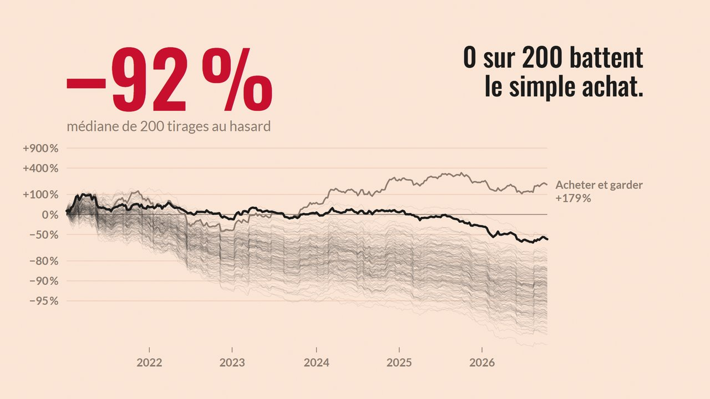
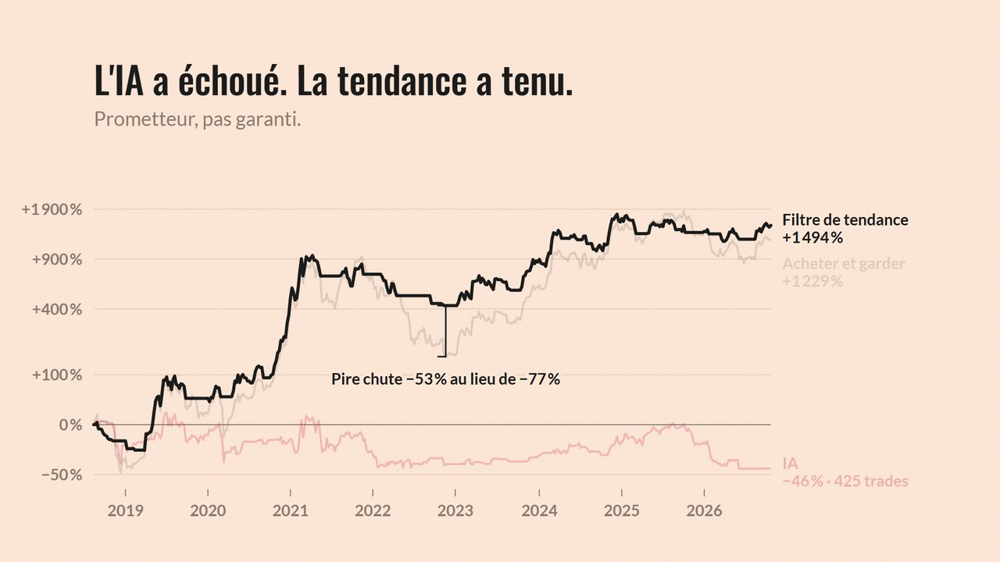

# Bot de trading crypto en Python

**Un bot de trading spot de bout en bout — données, backtest, recherche, exécution, monitoring — construit autour d'une seule question : _ce résultat est-il réel, ou est-ce que je me mens ?_**

   

## En 30 secondes

**1. Le backtest trop beau.** Une stratégie qui achète et vend *au hasard* affiche **+842 %** sur 2021-2026… tant qu'on oublie les frais. Avec 0,10 % par ordre : **−58 %**. Sur 200 tirages au hasard, **aucun** ne bat le simple « acheter et garder ».



**2. Un banc d'essai qui empêche de tricher.** Protocole de recherche [écrit et commité avant le moindre test](docs/RECHERCHE.md), walk-forward sur 8 ans de BTC (réglages choisis sur le passé, jugés sur l'avenir), frais et slippage partout, chaque stratégie confrontée à 200 tirages aléatoires.



| Hors échantillon, BTC 2018 → 2026 | Rendement | Sharpe | Pire chute | Verdict |
|---|---|---|---|---|
| Acheter et garder | +1 229 % | 0,83 | −77 % | référence |
| **Filtre de tendance** | +1 495 % | **1,00** | **−53 %** | prometteur (bat 97 % du hasard) |
| IA (régression logistique) | −46 % | 0,06 | −62 % | échec (surapprentissage) |
| Filtre de tendance sur 10 cryptos | — | 0,69 vs 0,68 | — | échec |

Les échecs sont publiés avec les succès : c'est tout l'intérêt d'un protocole pré-enregistré.

**3. Branché pour de vrai.** Prix en temps réel par WebSocket (≈ 6/s), **ordres exécutés sur le testnet Binance** (limit IOC, anti-doublon, réconciliation des soldes), stop-loss vérifié à chaque prix, kill switch, alertes et graphiques sur Telegram, déploiement Docker.

## Ce que le projet montre techniquement

- **Rigueur statistique** : détecteur automatique de look-ahead appliqué à chaque stratégie, walk-forward, témoin aléatoire calé sur l'exposition, tests multiples pris en compte, hypothèses déclarées avant les résultats.
- **Machine learning sans magie** : régression logistique écrite en numpy (IRLS + régularisation L2), évaluée honnêtement — et rejetée.
- **Systèmes temps réel** : asyncio + WebSocket (ccxt.pro) dans un fil dédié, reconnexion avec backoff, horloge robuste au décalage du PC, reprise exacte après crash (journal SQLite en WAL).
- **Exécution sûre** : un seul module a le droit d'envoyer un ordre (vérifié par un test), ordres IOC plafonnés, `clientOrderId` contre les doublons après coupure réseau, portefeuille propre au bot, mode réel verrouillé (flag `--live` + phrase tapée + clé sans droit de retrait).
- **Qualité** : 217 tests pytest sans réseau, type hints partout, config YAML validée (le levier est refusé par le code).

**Stack** : Python 3.12 · pandas · numpy · ccxt / ccxt.pro · asyncio · SQLite · matplotlib · Telegram Bot API · Docker · pytest

> **⚠ Avertissement.** Projet d'apprentissage et de recherche, **pas** une machine à gagner de l'argent : « prometteur » ne veut pas dire « gagnant », et les stratégies classiques (moyennes mobiles, Donchian, Bollinger/RSI) ne font pas mieux que le hasard une fois les frais comptés (voir [Résultats](#ce-que-disent-les-résultats)). Rien ici n'est un conseil financier.

**Garanties de conception**
- **Spot uniquement** : pas de futures, pas de levier, pas de marge (`max_exposure > 1` est refusé par le code).
- **Pas de look-ahead** : une décision prise à la clôture d'une bougie s'exécute à la suivante (testé).
- **Frais et slippage** dans tous les backtests.
- **Aucune clé dans le code** : tout passe par `.env` (exclu de git et de l'image Docker).
- **Le réel n'est jamais actif par défaut** : ordre des modes backtest → paper → testnet → live ; le live exige `--live` **et** une phrase de confirmation tapée dans un terminal.

---

## Sommaire

1. [Installation](#installation)
2. [Configuration](#configuration)
3. [Les commandes, mode par mode](#les-commandes-mode-par-mode)
4. [Alertes Telegram](#alertes-telegram)
5. [Déploiement 24/7 (Docker, VPS)](#déploiement-247-docker-vps)
6. [Architecture](#architecture)
7. [Tests](#tests)
8. [Ce que disent les résultats](#ce-que-disent-les-résultats)
9. [Limites connues](#limites-connues)
10. [Documentation](#documentation)

---

## Installation

Prérequis : **Python 3.12** (3.11 minimum ; les versions trop récentes comme 3.15 n'ont pas encore toutes les bibliothèques précompilées) et git.

```powershell
git clone https://github.com/npixdev/trading-bot.git
cd trading-bot
py -3.12 -m venv .venv                       # Linux/macOS : python3.12 -m venv .venv
.\.venv\Scripts\python.exe -m pip install -e ".[dev]"   # Linux/macOS : .venv/bin/pip install -e ".[dev]"
```

Dans la suite, `python` désigne `.\.venv\Scripts\python.exe` (Windows) ou `.venv/bin/python` (Linux/macOS).

## Configuration

| Fichier | Contenu | Versionné ? |
|---|---|---|
| `config/default.yaml` | données, coûts de backtest, garde-fous, paper, exécution | oui |
| `.env` | clés API, token Telegram (copier `.env.example`) | **jamais** |

Sections principales de `config/default.yaml` :

| Section | Rôle | Valeurs par défaut |
|---|---|---|
| `data` | historique à télécharger | Binance BTC/USDT 1h depuis 2021 |
| `backtest` | coûts simulés | frais 0,10 %, slippage 0,05 %, capital 10 000 |
| `risk` | garde-fous | taille ATR à 1 % de risque, stop 3 ATR, perte max 5 %/jour, kill switch −30 % |
| `paper` | stratégie temps réel | OKX BTC/USDT 1d, filtre de tendance adaptatif (validé par la recherche), taille 100 %, kill switch −60 % |
| `execution` | ordres réels | testnet Binance BTC/USDT, capital géré max 100, prix plafond ±0,2 % |

Les options de la ligne de commande surchargent le YAML. Chaque paramètre est commenté dans le fichier (pourquoi cette valeur, ce qui change si on la modifie).

## Les commandes, mode par mode

`python -m bot --help` liste tout ; `python -m bot <commande> --help` détaille une commande.

### 1. Données

```powershell
python -m bot fetch --exchange binance --symbol BTC/USDT --timeframe 1h --since 2021-01-01
python -m bot info                               # aperçu, trous, bougies incohérentes
```
Le téléchargement reprend là où il s'est arrêté ; cache Parquet dans `data/<exchange>/`.

### 2. Backtest

```powershell
python -m bot backtest --strategy sma --param fast=20 --param slow=100 --resample 1d
python -m bot backtest --strategy sma --param fast=20 --param slow=100 --resample 1d --split 0.7 --risk
python -m bot walkforward --strategy donchian --grid entry=20,55,100 --grid exit=10,20 --resample 4h
python -m bot compare                            # 3 stratégies × 1h/4h/1d, rapport HTML dans reports/
```
Stratégies : `buy_hold`, `random` (témoin), `sma`, `donchian`, `bollinger`, `alternate` (test d'exécution uniquement).
Toujours comparées au buy & hold ; `compare` les confronte aussi à 100 stratégies aléatoires de même exposition.

### Temps réel : comment le bot suit le marché

- **Flux WebSocket** : l'exchange pousse chaque nouveau prix (≈ 6 par seconde sur OKX) ; le stop-loss est vérifié à chaque prix, sans requête supplémentaire. Si le flux coupe, il se reconnecte seul et une vérification complète par requêtes a lieu toutes les `poll_seconds` (filet de sécurité). `--no-stream` pour le désactiver.
- **Décision à la clôture** : le bot se réveille quelques secondes après chaque clôture de bougie (≈ 10 s chez OKX, qui publie ses bougies avec un léger retard).
- **Pas de veille** : sous Windows, la mise en veille automatique du PC est bloquée tant que le bot tourne (`--allow-sleep` pour l'autoriser). Fermer le capot ou appuyer sur le bouton d'alimentation endort quand même le PC — pour du 24/7, un VPS reste la solution.

### 3. Paper trading (prix réels, portefeuille fictif, aucun compte nécessaire)

```powershell
python -m bot paper                              # réglages de la section paper
python -m bot paper --timeframe 1m --param fast=3 --param slow=10 --poll 10 --duration 300 --db data/demo.sqlite
python -m bot status                             # tableau de bord
```

### 4. Testnet (vrais ordres, fonds fictifs)

Testnet spot Binance : sans compte Binance ni KYC. Créer les clés : [docs/CLES_API.md](docs/CLES_API.md).

```powershell
python -m bot check-keys                         # permissions, soldes, minimums — aucun ordre
python -m bot trade                              # testnet par défaut
python -m bot status --mode testnet
```

### 5. Réel (déconseillé en l'état)

```powershell
python -m bot check-keys --live
python -m bot trade --live                       # + phrase « LIVE BTC/USDC 100 » à taper
```
Refusé si : la clé a le droit de retrait, les permissions sont invérifiables, les garde-fous sont désactivés, le terminal n'est pas interactif, ou la phrase est incorrecte. Le capital géré est plafonné (`execution.max_capital`). Nécessite un compte vérifié (KYC) sur l'exchange.

### Utilitaires

```powershell
python -m bot test-alert                         # envoie une alerte Telegram de test
python -m bot test-alert --db data/testnet.sqlite   # envoie l'état + le graphique de ce journal
python -m bot health --mode paper                # code 0 si le bot est vivant (heartbeat < 10 min)
```

## Alertes Telegram

Le bot envoie :
- **immédiatement** : chaque ordre, stop-loss, limite journalière, kill switch, crash, ordre rejeté/abandonné/non confirmé, écart avec le solde réel, démarrage/arrêt ;
- **au plus une fois par 30 min et par type** : erreurs réseau, exécutions partielles, resynchronisations d'horloge (avec le nombre d'occurrences regroupées) ;
- **chaque jour** (premier tour de boucle après minuit UTC) : un **graphique** (valeur du bot vs buy & hold, ▲ achats / ▼ ventes, périodes investies surlignées, drawdown) avec en légende la valeur du portefeuille, le rendement du jour et depuis le début, la position et l'état des garde-fous.

Messages mis en forme : 🟢 achat, 🔴 vente, 🛑 kill switch, ⚠️ anomalie, ✅ démarrage — toujours accompagnés d'un mot, jamais la couleur seule.

**Commandes à taper dans la conversation Telegram** (réponse en 1 à 3 s pendant que le bot tourne — un fil dédié écoute Telegram en continu, indépendamment de la boucle de trading) :

| Commande | Réponse |
|---|---|
| `/status` | état du bot + graphique, tout de suite |
| `/aide` | liste des commandes |

Elles sont **en lecture seule** (aucune ne peut faire trader le bot) et ne sont acceptées **que depuis ta conversation** (`TELEGRAM_CHAT_ID`) : si quelqu'un d'autre trouve ton bot, il est ignoré. Fautes de frappe tolérées (`/stats`, `statut`…) ; une commande inconnue reçoit l'aide. Les commandes envoyées pendant que le bot était arrêté (plus de 5 min) sont ignorées.

⚠ **Un seul bot à la fois par token Telegram** pour les commandes : si deux bots (ex. `paper` et `testnet` dans Docker) partagent le même token, Telegram refuse l'écoute simultanée. Crée un bot Telegram par instance, ou n'en fais tourner qu'une.

Une alerte qui échoue (Telegram injoignable) est journalisée et **n'interrompt jamais le trading**. Sans configuration, le bot tourne normalement, sans alertes.

**Mise en place (5 min)**
1. Dans Telegram, ouvre **@BotFather** → `/newbot` → choisis un nom. Il te donne un **token** (`123456:ABC…`) : c'est un secret, il donne le contrôle du bot Telegram.
2. Ouvre la conversation avec ton nouveau bot et envoie-lui un message (« bonjour »).
3. Dans `.env` : `TELEGRAM_BOT_TOKEN=<token>`, puis lance `python -m bot test-alert` : il affiche ton identifiant de conversation.
4. Ajoute `TELEGRAM_CHAT_ID=<identifiant>` dans `.env`, relance `python -m bot test-alert` : tu dois recevoir un message.

## Déploiement 24/7 (Docker, VPS)

Pourquoi un serveur : sur un PC, le bot s'arrête dès qu'il se met en veille — et le stop-loss (logiciel) avec lui. Un VPS reste allumé, a une IP fixe (utile pour restreindre une clé API) et coûte ~4-6 €/mois (1 vCPU, 1 Go de RAM suffisent).

### Avec Docker (sur ton PC ou sur le VPS)

```bash
cp .env.example .env            # puis remplir (Telegram, clés testnet)
docker compose up -d paper                        # paper trading 24/7
docker compose --profile testnet up -d testnet    # testnet 24/7
docker compose ps                                 # état + santé (healthy/unhealthy)
docker compose logs -f paper                      # journal en direct
docker compose exec paper python -m bot status    # tableau de bord
docker compose down                               # arrêt (l'état est conservé dans ./data)
```

- `restart: unless-stopped` : relancé automatiquement après un crash ou un redémarrage du serveur ; la reprise d'état repart exactement où il en était.
- `healthcheck` : le conteneur passe *unhealthy* si le heartbeat a plus de 10 min.
- Le journal SQLite vit dans `./data` (monté), la config est en lecture seule, `.env` n'entre jamais dans l'image (`.dockerignore`), le processus ne tourne pas en root.
- **Le mode réel n'est pas dans `docker-compose.yml`, volontairement** : il exige une confirmation tapée et ne doit pas démarrer sans surveillance.

### Préparer un VPS (Ubuntu/Debian) — checklist

1. Louer un petit VPS chez un hébergeur de ton choix ; se connecter en **SSH par clé** (pas par mot de passe).
2. Mettre à jour : `sudo apt update && sudo apt upgrade -y` ; activer les mises à jour de sécurité automatiques (`unattended-upgrades`).
3. Pare-feu : n'ouvrir que SSH (`sudo ufw allow OpenSSH && sudo ufw enable`). Le bot n'a besoin d'**aucun** port entrant.
4. **Horloge synchronisée** : `timedatectl` doit indiquer `System clock synchronized: yes` (sinon installer `chrony`). Les exchanges rejettent les requêtes horodatées de travers (vécu à l'étape 6 : 3,4 s d'écart).
5. Installer Docker (procédure officielle de docs.docker.com) et ajouter ton utilisateur au groupe `docker`.
6. Récupérer le code (`git clone` d'un dépôt **privé**), créer `.env` **sur le serveur** (`nano .env` ou `scp` depuis ton PC — jamais via un dépôt git ou une messagerie), `chmod 600 .env`.
7. `docker compose up -d paper`, puis vérifier `docker compose ps` et l'arrivée du message Telegram « ▶ Bot démarré ».
8. Mettre à jour plus tard : `git pull && docker compose up -d --build paper`.
9. Sauvegarder régulièrement `./data/*.sqlite` (le journal = l'historique de tout ce que le bot a fait).

**Ce que Docker ne couvre pas** : si le serveur entier tombe, personne n'envoie d'alerte. Pour être prévenu, il faut un « dead man's switch » externe (service qui t'alerte quand il ne reçoit plus de signal) — non inclus.

## Architecture

```
config/default.yaml      paramètres (commentés)
src/bot/
├── __main__.py          CLI : python -m bot <commande>
├── config.py            dataclasses de configuration (validées : levier refusé…)
├── portfolio.py         portefeuille spot partagé backtest / paper
├── data/                téléchargement ccxt paginé, cache Parquet, agrégation 1h→4h/1d, contrôles
├── strategies/          interface Strategy, indicateurs causaux, sma / donchian / bollinger / témoins
├── backtest/            moteur (exécution t+1), métriques, walk-forward, détecteur de look-ahead, témoin aléatoire
├── report/              comparaison hors échantillon + rapport HTML autonome
├── risk/                RiskManager : sizing ATR, stop-loss, limite journalière, exposition max, kill switch
├── realtime/            boucle temps réel commune paper/testnet/live : flux de prix, Trader, journal SQLite, suivi
├── execution/           SEUL endroit qui peut envoyer un ordre : PaperBroker, ExchangeBroker (IOC, anti-doublon), verrou live
└── monitoring/          alertes Telegram, résumé quotidien, heartbeat
tests/                   pytest (toute la logique de calcul, de risque et d'exécution)
docs/                    BASES.md, GLOSSAIRE.md, CLES_API.md
```

Principe clé : la même stratégie et le même `RiskManager` servent en backtest et en temps réel ; seul le **broker** change (simulé ou réel).

## Tests

```powershell
python -m pytest -q
```
Ils couvrent notamment : absence de look-ahead (moteur et chaque stratégie de chaque grille), coûts exacts d'un aller-retour, non-fuite des données de test dans l'optimisation, chaque garde-fou avec un scénario chiffré, reprise après crash, refus du levier et du réel sans confirmation, ordres partiels/rejetés/perdus sur le réseau sans double exécution, alertes qui ne cassent jamais le trading. Aucun test n'appelle le réseau.

## Ce que disent les résultats

Hors échantillon (walk-forward, janv. 2022 → oct. 2026, frais 0,10 % + slippage 0,05 %) :

| | 1h | 4h | 1d |
|---|---|---|---|
| Buy & hold | +72 % | +75 % | +76 % |
| SMA | +23 % | +59 % | +36 % |
| Donchian | −22 % | +98 % | +23 % |
| Bollinger/RSI | −79 % | −32 % | +15 % |

Aucune combinaison ne fait mieux que 90 % des stratégies aléatoires de même exposition ; la meilleure (Donchian 4h, 89 %) est cohérente avec la chance vu le nombre d'essais. Ces stratégies réduisent les chutes (drawdown −33 % à −52 % contre −67 %), **mais le hasard investi aussi souvent en fait autant**. Le timeframe 1h est le pire (frais). Détails : `python -m bot compare`.

### Recherche pré-enregistrée (2018 → 2026, bougies journalières)

Protocole écrit et commité **avant** tout test : [docs/RECHERCHE.md](docs/RECHERCHE.md). Commande : `python -m bot research`.

| | Rendement | Sharpe | Max drawdown | Verdict |
|---|---|---|---|---|
| Buy & hold | +1 229 % | 0,83 | −76,6 % | référence |
| DCA 52 semaines | +1 474 % | 0,87 | −76,6 % | référence |
| Filtre de tendance | +1 495 % | **1,00** | **−53,0 %** | prometteuse (bat 97 % du hasard) |
| Tendance + volatilité | +748 % | **0,91** | **−44,1 %** | prometteuse |
| Ciblage de volatilité | +314 % | 0,60 | −76,0 % | échec |
| IA (régression logistique) | −45,7 % | 0,06 | −61,6 % | échec (surapprentissage, 425 trades) |

Le filtre de tendance gagne **en évitant les krachs** (2018, 2022), pas en montant plus vite : il fait nettement moins bien que le buy & hold dans les années de forte hausse. *Prometteuse* ≠ *gagnante*.

## Limites connues

- **Stop-loss logiciel** : il n'agit que si le bot tourne.
- **Testnet ≠ marché réel** : carnet séparé, prix et liquidité différents, **frais nuls** (les frais réels n'ont pas été mesurés).
- **Ordres partiels, rejets, coupures réseau pendant un envoi** : couverts par les tests unitaires, pas encore observés en conditions réelles.
- **Backtests** : les données BTC/USDT de Binance servent de référence ; le marché réel visé (OKX BTC/USDC) a des frais et un spread propres.
- **Docker** : fichiers écrits et vérifiés statiquement (tests), à valider sur une machine avec Docker.
- **Fiscalité (France)** : les plus-values en euros sont imposables, et les comptes sur des plateformes étrangères se déclarent — voir [docs/BASES.md](docs/BASES.md).

## Documentation

- [docs/BASES.md](docs/BASES.md) — comment fonctionne un exchange, les ordres, les frais, pourquoi la plupart des bots perdent, choix de l'exchange.
- [docs/GLOSSAIRE.md](docs/GLOSSAIRE.md) — tous les termes, avec un exemple chiffré.
- [docs/CLES_API.md](docs/CLES_API.md) — créer des clés API en sécurité (testnet Binance, OKX).
